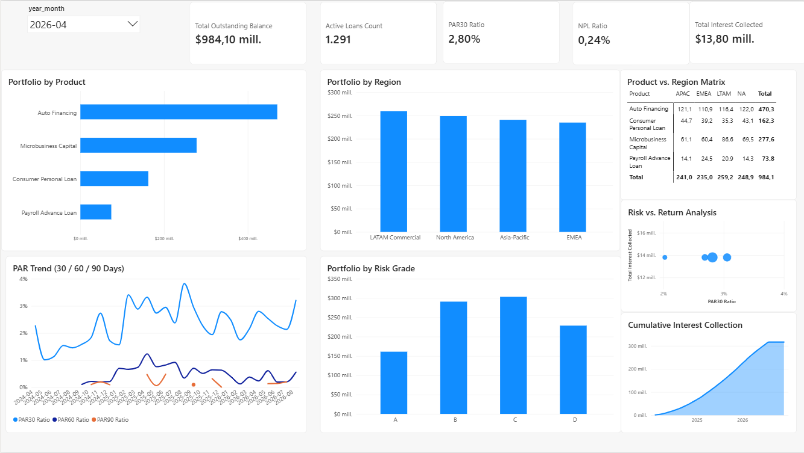

PowerShellSet-Content -Path "README.md" -Value @'
# Commercial Credit Risk & Loan Portfolio Analytics Mart

An end-to-end credit risk and loan portfolio analytics pipeline implementing a Kimball dimensional star schema in **DuckDB/SQL**, synthetic data engineering in **Python**, automated SQL data quality validation via **GitHub Actions CI/CD**, and semantic modeling in **Power BI (PBIP/TMDL)**.



---

## 1. Executive Summary & Business Insights (April 2026 Snapshot)

- **Total Outstanding Balance:** **$984.10M** across **1,291 active loans**.
- **Portfolio Concentration:** **Auto Financing** represents the largest single lending product exposure (~$470.3M), followed by **Microbusiness Capital** (~$277.6M).
- **Regional Distribution:** Credit deployment is balanced across **LATAM Commercial** ($259.2M), **North America** ($248.9M), **APAC** ($241.0M), and **EMEA** ($235.0M).
- **Credit Quality & Delinquency:**
  - **PAR30 Ratio:** **2.80%**
  - **NPL Ratio:** **0.24%**
  - Bulk of risk exposure resides in Risk Grades **B** and **C** (~$290M and ~$305M respectively), reflecting a controlled credit expansion profile.
- **Revenue Realization:** Monthly interest collected stands at **$13.80M**, with **Cumulative Interest Collection** accelerating smoothly toward **$300M+** across the multi-year cycle.

---

## 2. Architecture & Dimensional Model (Star Schema)

```text
              ┌──────────────┐
              │   dim_date   │
              └──────┬───────┘
                     │ 1:N
┌──────────────┐     │     ┌─────────────┐
│ dim_customer ├─────┼─────┤ dim_product │
└──────┬───────┘     │     └──────┬──────┘
       │ 1:N         │            │ 1:N
       │      ┌──────┴──────┐     │
       └──────┤   dim_loan  ├─────┘
              └──────┬──────┘
                     │ 1:N
       ┌─────────────┴─────────────┐
       ▼                           ▼
┌───────────────────────────┐ ┌─────────────────────────┐
│ fct_loan_monthly_snapshot │ │   fct_daily_repayment   │
└───────────────────────────┘ └─────────────────────────┘
Storage & Engine: Synthetic portfolio generation using Python (pandas, numpy), loaded and modeled locally in DuckDB.Governance & QA: Automated SQL test suite (sql/02_data_quality_tests.sql) verifying foreign key integrity, non-negative loan balances, credit score boundaries (300–850), and Days Past Due (DPD) consistency.CI/CD: Automated pipeline in .github/workflows/ci.yml executing data quality checks on every push and pull request to main.BI Semantic Layer: Microsoft Power BI Project (.pbip) format with Tabular Model Definition Language (.tmdl) files and centralized DAX risk measures.3. Core Quantitative & DAX Risk MetricsPortfolio at Risk (PAR 30 / 60 / 90):$$\text{PAR 30 Ratio} = \frac{\sum \text{Outstanding Principal } (\text{DPD} > 30)}{\sum \text{Outstanding Principal}}$$Non-Performing Loan (NPL) Ratio:$$\text{NPL Ratio} = \frac{\sum \text{Outstanding Principal } (\text{DPD} \ge 90)}{\sum \text{Outstanding Principal}}$$Vintage Analysis Curve:$$\text{Cumulative Default Rate} = \frac{\text{NPL Amount at MOB } t}{\text{Original Originated Principal of Cohort}}$$4. Repository StructurePlaintextcredit-risk-loan-analytics/
├── .github/workflows/
│   └── ci.yml                           # Automated ETL & SQL QA workflow
├── CreditRiskAnalytics.SemanticModel/   # Tabular model, relationships & DAX (.tmdl)
├── CreditRiskAnalytics.Report/          # Power BI report layout & visuals (.pbir)
├── CreditRiskAnalytics.pbip             # Power BI Project entrypoint
├── docs/
│   └── data_dictionary.md               # Business glossary & schema definitions
├── scripts/
│   ├── generate_loan_portfolio_data.py  # Synthetic portfolio generator
│   └── run_quality_checks.py            # DuckDB SQL test runner
├── sql/
│   ├── 01_schema_ddl.sql                # Star schema DDL statements
│   └── 02_data_quality_tests.sql        # Automated data governance assertions
└── README.md